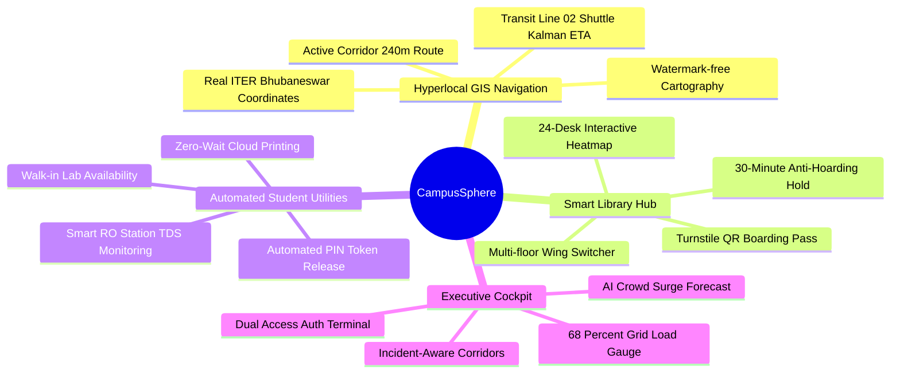
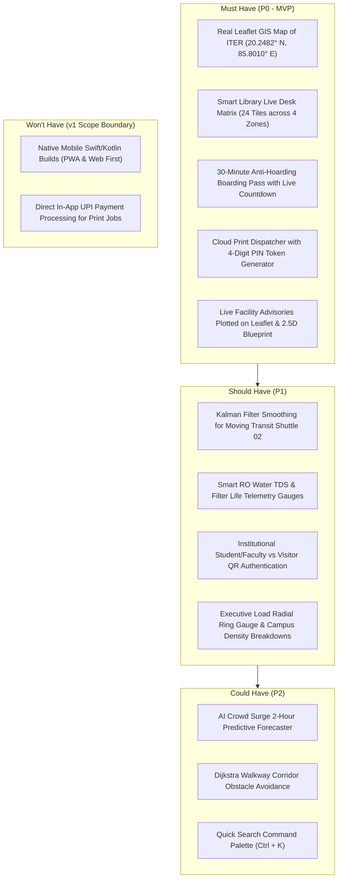
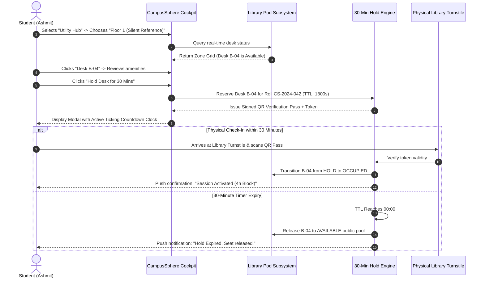

# Product Requirements Document (PRD)
## CampusSphere // Unified Student Utilities & Hyperlocal Campus Navigation

**Document Version:** 1.0.0  
**Target Institution:** ITER, Siksha 'O' Anusandhan (SOA) Deemed to be University, Bhubaneswar, Odisha  
**Project Lead & Author:** Hackathon Core Team (Hritik Raj)  
**Status:** Approved for Implementation  

---

## 1. Executive Summary & Vision

University campuses spanning dozens of acres frequently suffer from operational fragmentation. At ITER Bhubaneswar (home to over 12,000 engineering students), students experience acute bottlenecks:
1. **Exam-Time Library Overcrowding & Seat Hoarding:** Students place notebooks on desks to reserve study spaces for hours without being present.
2. **Printer Queue Surges:** High-volume queues at central copy centers cause students to miss lecture assignment deadlines.
3. **Hyperlocal Navigation Blind Spots:** First- and second-year students navigate between distant blocks (Gate 1, Bansuri Guru Auditorium, Block B CSE Wing, E-Block Lawn) without real-time corridor advisory telemetry.
4. **Transit & Utility Invisibility:** Students wait unpredictably for campus shuttles and encounter offline RO hydration stations.

**CampusSphere** solves these challenges as a unified **Digital Campus Twin and Hyperlocal Operations Cockpit**, combining real GIS navigation, an anti-hoarding 30-minute library hold mechanism, automated cloud printing with 4-digit PIN release, and telemetry monitoring.

---

## 2. Target Personas

| Persona | Role | Primary Goal | Critical Pain Point |
| :--- | :--- | :--- | :--- |
| **Ashmit Verma** | 2nd Year CSE Student | Secure quiet study pod in Central Library & submit lab printouts between classes. | Finding desks occupied only by empty bags; 15-minute printer lines. |
| **Priyanka Dash** | Day Scholar Commuter | Catch Transit Line 02 at Gate 1 Bay to reach Bansuri Guru Auditorium on time. | Missing campus shuttles due to unannounced delays; no live ETA. |
| **Prof. S. Patnaik** | Lab In-Charge (Lab 304) | Regulate walk-in capacity for IoT and embedded systems hardware kits. | Overcrowded benches during project submissions; untracked equipment. |
| **Er. R. K. Mohanty** | Facilities & Utilities Lead | Maintain hydration stations and copy center toners proactively. | Unreported filter failures causing student frustration at Block B. |

---

## 3. MoSCoW Feature Prioritization

---

## 4. User Journey: Library Hold to Turnstile Check-In

---

## 5. Success Metrics & Key Performance Indicators (KPIs)

1. **Desk Utilization & Turnover Efficiency:**
   - Eliminate ghost hoarding by **>85%** within 2 weeks of campus rollout.
   - Boost daily seat turnover from 2.1 to **4.3 students per desk**.
2. **Print Dispatch Velocity:**
   - Reduce peak-hour wait times at Academic Library Xerox from 8.5 minutes to **<90 seconds** using automatic load-balanced rerouting to CS Annex.
3. **Transit Punctuality & Predictability:**
   - Provide sub-30-second arrival accuracy for Transit Line 02 at Gate 1 and Bansuri Guru bays.
4. **User Engagement & Reliability:**
   - Zero-crash frontend performance (<0.1% error rate).
   - <1.2 second time-to-interactive on campus Wi-Fi.
