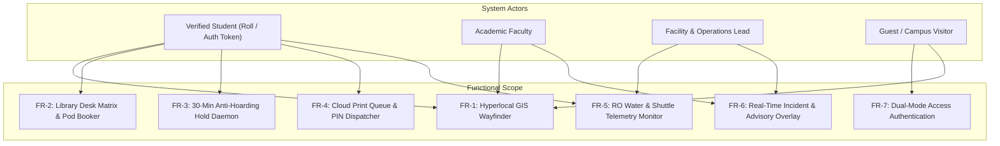
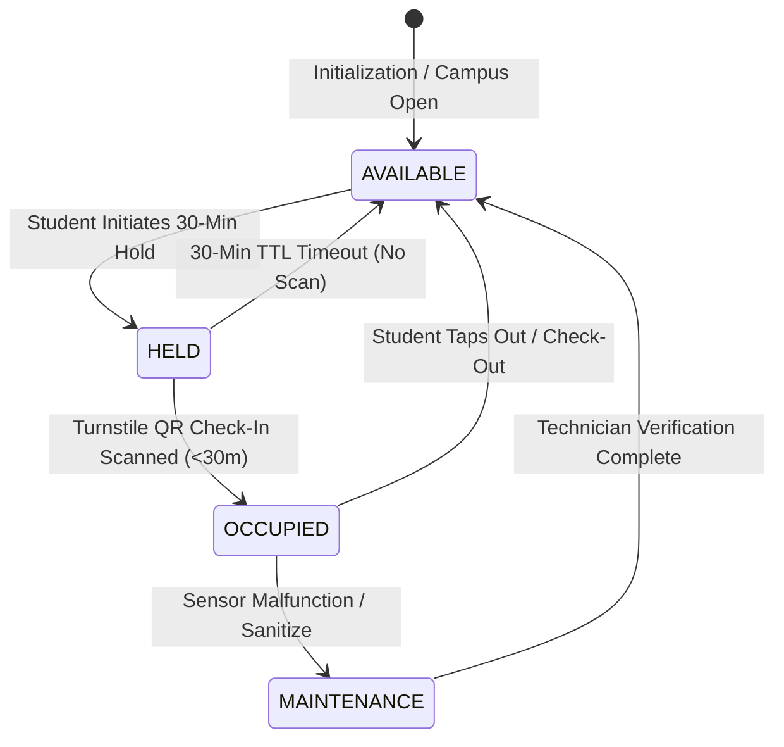
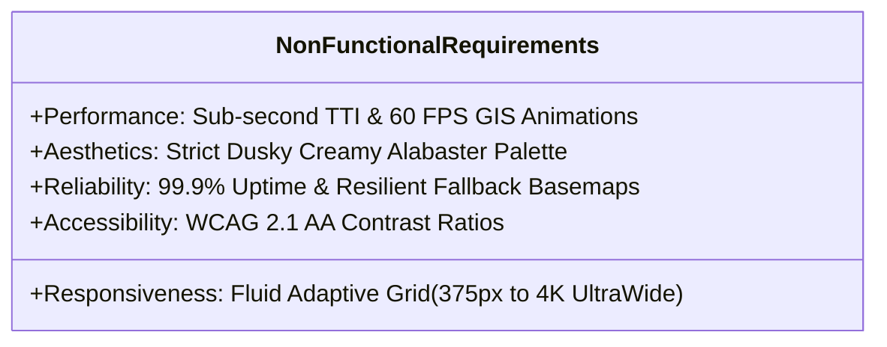

# Software Requirements Specification (SRS)
## CampusSphere // Unified Student Utilities & Hyperlocal Campus Navigation

**Document ID:** SRS-CS-2026-V1  
**Standard Compliance:** IEEE 830-1998 Recommended Practice for SRS  
**Target Deployment:** ITER Campus, SOA University, Bhubaneswar, Odisha  

---

## 1. Introduction

### 1.1 Purpose
This document specifies the software requirements for **CampusSphere**, an integrated web-based campus operations dashboard, smart library seat allocation system, hyperlocal GIS corridor wayfinder, and automated student utility dispatcher.

### 1.2 System Overview
CampusSphere bridges physical campus infrastructure (turnstiles, printers, RO plants, overhead sensors) with an executive student cockpit. The application uses modern client-side React 19 architecture backed by Leaflet GIS and SVG isometric rendering engines.

---

## 2. Functional Requirements (FR)

### FR-1: Hyperlocal GIS Navigation Engine
- **FR-1.1:** The system shall render an interactive Leaflet GIS map centered at `20.2482° N, 85.8010° E` with minZoom 15 and maxZoom 19.
- **FR-1.2:** The map shall plot the verified active pedestrian corridor connecting ITER Gate 1, Central Library, and Block B (Lab 304) with an exact 240m route trace.
- **FR-1.3:** The system shall plot real-time animated shuttle positions along the Khandagiri-ITER perimeter ring with simulated Kalman filter interpolation.

### FR-2: Smart Library Desk Matrix & Pod Booker
- **FR-2.1:** The system shall display a real-time matrix of 24–32 desk tiles per floor across 4 distinct zones (Zone A General, Zone B Window, Pods C, Quiet Room D).
- **FR-2.2:** Each desk tile shall visually indicate real-time status: Available (`#6F8F72`), Occupied (`#3F3B36`), or Temporary Hold (`#D4A373`).
- **FR-2.3:** Selecting an available desk shall dynamically update the booking sidebar with amenities, electrical outlet count, and Wi-Fi 6 availability.

### FR-3: 30-Minute Anti-Hoarding Reservation Lifecycle
- **FR-3.1:** When a user initiates a hold on an available desk, the system shall transition desk state to `HELD` and lock it against other reservations for exactly 1,800 seconds (30 minutes).
- **FR-3.2:** The system shall generate a cryptographically verifiable Digital Library Pass containing a dynamic QR code and countdown clock.
- **FR-3.3:** Upon turnstile scanning before expiry, the desk state transitions to `OCCUPIED`. If the countdown expires without check-in, the desk automatically reverts to `AVAILABLE`.

### FR-4: Automated Cloud Print Dispatcher
- **FR-4.1:** The system shall provide a mock drag-and-drop document upload interface supporting PDF and DOCX file formats.
- **FR-4.2:** The system shall calculate station queues and route jobs to the least congested terminal (e.g., rerouting from Central Library to CS Annex).
- **FR-4.3:** Upon dispatch confirmation, the system shall generate a secure 4-digit PIN release token to be entered at physical printer terminals.

### FR-5: RO Hydration & Transit Telemetry
- **FR-5.1:** The system shall stream real-time TDS levels (ppm), filter health percentages, and chiller status for all academic blocks.
- **FR-5.2:** When a station's filter reaches critical thresholds or scheduled maintenance, the system shall flag the station as offline and auto-recommend the closest active alternative.

---

## 3. Non-Functional Requirements (NFR)

### NFR-1: Aesthetic Integrity & Color Standards
- **NFR-1.1:** Canvas background must strictly maintain Dusky Warm Creamy Alabaster (`#F7F5F0`).
- **NFR-1.2:** Card surfaces must use soft off-white linen (`#FFFFFF` with `1px solid #E5DFD5` border and subtle warm drop shadows).
- **NFR-1.3:** Strictly NO pure pitch black (`#000000`) and NO generic high-contrast dark modes.

### NFR-2: Performance & Latency
- **NFR-2.1:** Page initial load time must remain under **1.5 seconds** on 4G cellular connections.
- **NFR-2.2:** Leaflet canvas map panning and shuttle animation loop must sustain **60 FPS** without layout thrashing.
- **NFR-2.3:** Production JavaScript bundle must remain below 550 kB gzipped.

### NFR-3: Security & Privacy
- **NFR-3.1:** Student institutional roll numbers and credentials must be validated via client-side sanitization.
- **NFR-3.2:** QR Pass tokens must utilize short-lived time-based tokens preventing replay attacks.
