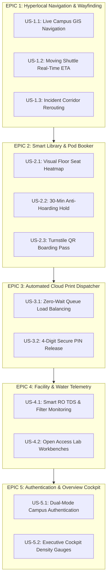

# User Stories & Acceptance Criteria
## CampusSphere // Unified Student Utilities & Hyperlocal Campus Navigation

**Methodology:** Agile / Scrum Framework  
**Epic Hierarchy:** 5 Core Epics | 12 User Stories | Gherkin BDD Specifications  

---

## 1. User Story Mapping Matrix



---

## 2. Detailed User Stories & BDD Acceptance Criteria

### US-1.1: Live Campus GIS Navigation
**As a** student traveling across campus,  
**I want to** view a real GIS map of ITER with landmarks like Gate 1, Central Library, and Block B,  
**So that** I can reach my scheduled lecture with precision without getting lost.

```gherkin
Scenario: Student inspects the pedestrian route between Gate 1 and Block B
  Given the student is authenticated in the CampusSphere Cockpit
  When the student selects the "Wayfinder & Maps" tab
  Then the map should render centered at coordinates [20.2482, 85.8010]
  And an active terracotta corridor polyline of 240m should link Gate 1 to Block B
  And landmark markers for ITER Gate 1, Library, Bansuri Guru, and Block B must be clickable
```

---

### US-1.2: Moving Shuttle Real-Time Tracking
**As a** day scholar commuter,  
**I want to** observe the live location of Transit Line 02 along the campus perimeter road,  
**So that** I know exactly when to walk to the Gate 1 Shuttle Bay.

```gherkin
Scenario: Real-time countdown for arriving shuttle
  Given the student views the bottom transit banner in the Hero card
  When the shuttle timer ticks down
  Then the countdown should display in "MM:SS" format
  And the moving bus marker on the map ring road should advance smoothly along its coordinates
```

---

### US-2.1: Visual Library Seat Heatmap
**As an** engineering student during midterm exams,  
**I want to** see live availability of desks and study pods across different library floors,  
**So that** I do not waste time searching aisle by aisle in overcrowded quiet zones.

```gherkin
Scenario: Selecting a study floor in the Utility Hub
  Given the student is in the "Utility Hub" tab
  When the student clicks on "1st Floor — Silent Reference & Thesis Wing"
  Then the grid should update to display 24 desk tiles divided into 4 study zones
  And green tiles indicate available desks, charcoal indicates occupied, and amber indicates held
```

---

### US-2.2 & 2.3: 30-Minute Anti-Hoarding Hold & QR Pass
**As a** library patron,  
**I want to** place a temporary 30-minute hold on a desk while walking over,  
**So that** my seat is guaranteed without allowing absent students to hoard desks all day.

```gherkin
Scenario: Reserving a desk and receiving an active QR boarding pass
  Given the student has selected available "Desk B-04" on the 1st Floor
  When the student clicks "Hold Desk for 30 Mins"
  Then a modal with a Digital Library Pass and SVG QR code should appear
  And a live countdown timer starting at 30:00 should tick down every second
  And the pass must state: "Must scan at library turnstile within 30 minutes"
```

---

### US-3.1 & 3.2: Automated Cloud Print & PIN Generation
**As a** lab student needing project printouts,  
**I want to** submit my PDF to the cloud print dispatcher and receive a 4-digit PIN,  
**So that** I can walk directly to the printer terminal and release my pages instantly.

```gherkin
Scenario: Submitting a print job to an optimal station
  Given the Central Library Xerox has 6 queued jobs
  When the student opens the Cloud Print modal and selects "CS Annex Terminal"
  And clicks "Generate Secure Print Release Token"
  Then the system generates a random 4-digit PIN (e.g. 7842)
  And displays a success confirmation toast with terminal pickup instructions
```

---

### US-4.1: Smart RO Hydration Station Status
**As an** athlete or student between classes,  
**I want to** check water station filter life and TDS metrics,  
**So that** I avoid broken dispensers and find cold purified water quickly.

```gherkin
Scenario: Viewing an offline hydration advisory
  Given Block B dispenser is offline for scheduled cartridge maintenance
  When the user views the Facility Advisories sidebar or map overlay
  Then a warning indicator should display: "Offline until 14:00"
  And the system must auto-recommend the closest active alternative: "Block C 2nd Floor (TDS: 112 ppm)"
```
