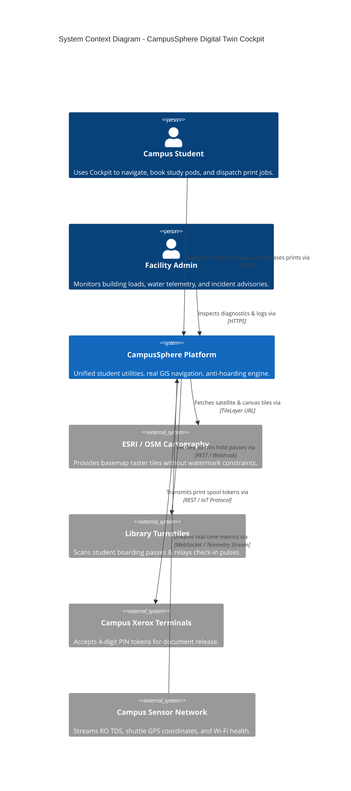
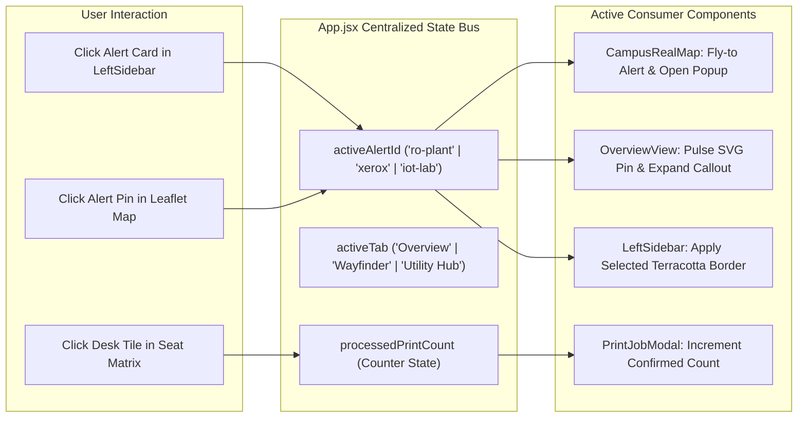

# System Architecture & Component Design
## CampusSphere // Unified Student Utilities & Hyperlocal Campus Navigation

**Architecture Model:** C4 Architectural Blueprint & Modular Component Hierarchy  
**Frontend Framework:** React 19 + Vite 8 (Modern ESM Single Page Application)  
**Mapping Subsystems:** Leaflet GIS (Spherical Mercator EPSG:3857) & Custom 2.5D Isometric SVG  

---

## 1. C4 Container Diagram

---

## 2. Frontend React Component Hierarchy

```mermaid
graph TD
    App["App.jsx (Root State, View Routing, Modals, Toasts)"]
    
    App --> Login["LoginPage.jsx (Auth Terminal, Role Demo Chips, Pulse)"]
    App --> Header["HeaderBar.jsx (Segmented Tabs, Search Pill, Avatar)"]
    
    App --> OverviewView["OverviewView.jsx (Executive Cockpit)"]
    OverviewView --> OverviewLeft["Facility Advisories & Radial Load Gauge"]
    OverviewView --> OverviewHero["2.5D Isometric Blueprint Banner & Route"]
    OverviewView --> OverviewRight["Print Queue & AI Surge Predictor"]
    
    App --> WayfinderGrid["Wayfinder View (3-Column Cockpit)"]
    WayfinderGrid --> LeftSidebar["LeftSidebar.jsx (Live Alerts, Quick Pills, Radial)"]
    WayfinderGrid --> CenterMainHero["CenterMainHero.jsx (Hero Header & Transit Banner)"]
    CenterMainHero --> CampusRealMap["CampusRealMap.jsx (Leaflet GIS, Alert Markers)"]
    WayfinderGrid --> RightSidebar["RightSidebar.jsx (Print Stats, 2h AI Load)"]

    App --> UtilityHubView["UtilityHubView.jsx (Smart Library Hub)"]
    UtilityHubView --> MetricsBanner["3-Card Quick Utility Summary Bar"]
    UtilityHubView --> SeatMatrix["Seat Matrix Grid (24 Tiles across 4 Zones)"]
    UtilityHubView --> BookingSidebar["30-Min Hold Sidebar & Confirmation Modal"]
    UtilityHubView --> CompanionGrid["Cloud Print Dispatcher & RO Telemetry"]

    App --> PrintJobModal["PrintJobModal.jsx (Secure PIN Token Dialog)"]
    App --> LogsModal["InfrastructureLogsModal.jsx (Diagnostic Telemetry)"]
    App --> QuickSearchModal["QuickSearchModal.jsx (Cmd + K Command Palette)"]
```

---

## 3. Data Flow & Cross-Component Communication

---

## 4. Mapping Subsystem Technical Specifications

### A. GIS Leaflet Layer Integration
1. **Projection**: EPSG:3857 (Web Mercator WGS 84).
2. **Tile Architecture**:
   - Primary: `ESRI World Light Gray Canvas` with CSS post-processing (`sepia(0.2) saturate(1.15) brightness(1.02)`).
   - Aerial: `ESRI World Imagery` (high-detail satellite photogrammetry).
   - Blueprint: `OpenStreetMap Standard` cartographic vectors.
3. **Marker Generation**: Leaflet `L.divIcon` HTML vector markers styled with pure CSS to avoid external image asset 404s.

### B. 2.5D Isometric SVG Blueprint Engine
1. **Mathematical Projection**: 30-degree isometric affine transformation with SVG gradients (`linearGradient` top/side shading).
2. **Animation**: SVG stroke dasharray animated polyline (`cs-dotted-flow-path`) simulating dynamic footstep cadence.
3. **Interactive Pin Overlays**: Dynamic SVG coordinate anchors mapped above architectural polygons.
