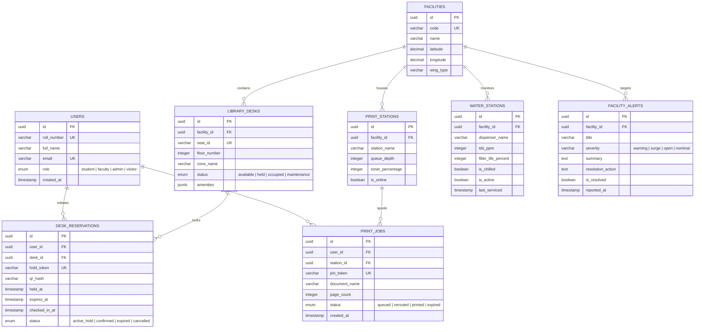

# Database Design & Telemetry Schema
## CampusSphere // Unified Student Utilities & Hyperlocal Campus Navigation

**Storage Paradigm:** Hybrid Polyglot Persistence  
- **Primary Relational Store:** PostgreSQL 16 (ACID-compliant relational schemas for users, desks, reservations, and facilities).  
- **In-Memory Cache & TTL Store:** Redis 7.2 (Real-time 1,800-second desk reservation locks, shuttle Kalman telemetry, and print spools).  

---

## 1. Entity-Relationship Diagram (ERD)



---

## 2. PostgreSQL Relational Schemas (DDL)

```sql
-- Enable UUID extension
CREATE EXTENSION IF NOT EXISTS "uuid-ossp";

-- 1. Users Table
CREATE TABLE users (
    id UUID PRIMARY KEY DEFAULT uuid_generate_v4(),
    roll_number VARCHAR(32) UNIQUE NOT NULL,
    full_name VARCHAR(128) NOT NULL,
    email VARCHAR(128) UNIQUE NOT NULL,
    role VARCHAR(20) DEFAULT 'student' CHECK (role IN ('student', 'faculty', 'admin', 'visitor')),
    created_at TIMESTAMP WITH TIME ZONE DEFAULT CURRENT_TIMESTAMP
);

-- 2. Library Desks Table
CREATE TABLE library_desks (
    id UUID PRIMARY KEY DEFAULT uuid_generate_v4(),
    seat_id VARCHAR(16) UNIQUE NOT NULL,
    floor_number INT NOT NULL,
    zone_name VARCHAR(64) NOT NULL,
    status VARCHAR(20) DEFAULT 'available' CHECK (status IN ('available', 'held', 'occupied', 'maintenance')),
    amenities JSONB DEFAULT '{"power_outlet": true, "wifi_6": true, "silent_zone": true}',
    updated_at TIMESTAMP WITH TIME ZONE DEFAULT CURRENT_TIMESTAMP
);
CREATE INDEX idx_desk_status ON library_desks(status);
CREATE INDEX idx_desk_floor ON library_desks(floor_number);

-- 3. Desk Reservations Table (30-Minute Hold Engine)
CREATE TABLE desk_reservations (
    id UUID PRIMARY KEY DEFAULT uuid_generate_v4(),
    user_id UUID NOT NULL REFERENCES users(id) ON DELETE CASCADE,
    desk_id UUID NOT NULL REFERENCES library_desks(id) ON DELETE CASCADE,
    hold_token VARCHAR(64) UNIQUE NOT NULL,
    qr_hash VARCHAR(256) NOT NULL,
    held_at TIMESTAMP WITH TIME ZONE DEFAULT CURRENT_TIMESTAMP,
    expires_at TIMESTAMP WITH TIME ZONE NOT NULL,
    checked_in_at TIMESTAMP WITH TIME ZONE,
    status VARCHAR(20) DEFAULT 'active_hold' CHECK (status IN ('active_hold', 'confirmed', 'expired', 'cancelled'))
);
CREATE INDEX idx_res_expires ON desk_reservations(expires_at) WHERE status = 'active_hold';
CREATE INDEX idx_res_token ON desk_reservations(hold_token);
```

---

## 3. Redis In-Memory Cache Key Topology

To guarantee microsecond response times and automated zero-leak expiry, high-velocity campus data utilizes Redis keys with strict Time-To-Live (TTL):

| Key Pattern | Redis Type | TTL | Purpose |
| :--- | :--- | :--- | :--- |
| `lock:desk:{seat_id}` | String | 1,800s (30m) | Distributed mutex preventing race conditions during 30-min holds. |
| `telemetry:shuttle:line02` | Hash | None | Live Kalman-smoothed GPS coordinates `lat`, `lng`, `speed`, `next_eta`. |
| `print:token:{pin_token}` | Hash | 3,600s (1h) | Maps 4-digit release PIN to user ID, document reference, and target printer. |
| `cache:alerts:active` | Set | 300s (5m) | Active campus advisories plotted onto GIS Leaflet and 2.5D blueprint maps. |
| `stats:campus:load` | Hash | 60s (1m) | Aggregated campus headcounts (1,420 entries) and grid density ratio (68%). |
