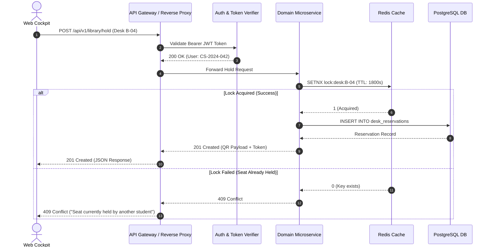

# API Specification & Data Contracts
## CampusSphere // Unified Student Utilities & Hyperlocal Campus Navigation

**API Standard:** RESTful JSON HTTP/2 & WebSocket Telemetry  
**Base URL:** `https://api.campussphere.iter.soa.ac.in/v1`  
**Authentication Scheme:** Bearer Token (JWT) in `Authorization` header  

---

## 1. API Architecture & Request Sequence



---

## 2. Core Endpoints Reference

### A. Library Pod & Desk Management

#### `POST /library/hold`
Initiates a 30-minute anti-hoarding hold on a specific library desk.

**Request Payload:**
```json
{
  "seat_id": "B-04",
  "floor_number": 1,
  "wing": "Silent Reference & Thesis Wing"
}
```

**Response (201 Created):**
```json
{
  "status": "success",
  "data": {
    "reservation_id": "res_8f3a9e21",
    "seat_id": "B-04",
    "floor": 1,
    "held_at": "2026-10-15T12:00:00Z",
    "expires_at": "2026-10-15T12:30:00Z",
    "ttl_seconds": 1800,
    "qr_token": "cs_qr_b04_a98f12c8e3",
    "verification_pin": "7842"
  }
}
```

#### `POST /library/verify-qr`
Invoked by turnstile optical scanners when student scans boarding pass.

**Request Payload:**
```json
{
  "qr_token": "cs_qr_b04_a98f12c8e3",
  "turnstile_id": "turnstile_lib_main_02"
}
```

**Response (200 OK):**
```json
{
  "verified": true,
  "seat_id": "B-04",
  "user": {
    "name": "Ashmit Verma",
    "roll": "CS-2024-042"
  },
  "session_status": "ACTIVE_OCCUPIED",
  "access_granted": true
}
```

---

### B. Cloud Print Dispatcher

#### `POST /print/spool`
Dispatches a document to the campus print routing network and calculates optimal terminal routing.

**Request Payload:**
```json
{
  "document_name": "CS302_Data_Structures_Lab4.pdf",
  "page_count": 14,
  "preferred_station": "station_lib_ground",
  "color_mode": "monochrome",
  "duplex": true
}
```

**Response (200 OK):**
```json
{
  "job_id": "job_prn_99182",
  "allocated_station": {
    "id": "station_cs_annex_01",
    "name": "CS Annex Ground Terminal",
    "queue_depth": 0,
    "estimated_wait_seconds": 15,
    "rerouted_from": "station_lib_ground",
    "reroute_reason": "High queue buffer (6 jobs pending at Library Xerox)"
  },
  "pin_token": "7842",
  "token_expiry": "2026-10-15T13:30:00Z"
}
```

---

### C. Live Facility Telemetry & Map Advisories

#### `GET /telemetry/advisories`
Fetches active campus advisories plotted onto GIS Leaflet and 2.5D blueprint maps.

**Response (200 OK):**
```json
{
  "advisories_count": 3,
  "advisories": [
    {
      "id": "ro-plant",
      "facility": "Block B Ground RO",
      "title": "Central RO Plant // Filter Servicing",
      "badge": "Offline till 14:00",
      "severity": "warning",
      "coords": [20.2477, 85.8024],
      "summary": "Block B ground dispenser offline for scheduled cartridge servicing till 14:00.",
      "solution": "Hydration Station at Block C 2nd Floor is Active & Chilled (TDS: 112 ppm — 60m walk)."
    },
    {
      "id": "xerox",
      "facility": "Central Library Print",
      "title": "Academic Library Xerox // Queue Surge",
      "badge": "Queue Surge (6 Jobs)",
      "severity": "surge",
      "coords": [20.2486, 85.8006],
      "summary": "6 jobs in buffer, estimated delay ~8 minutes at ground desk.",
      "solution": "Auto-rerouted: Send jobs to CS Annex Ground Terminal (Zero wait time • 1 min saved)."
    },
    {
      "id": "iot-lab",
      "facility": "IoT Lab 304 (Block B)",
      "title": "IoT Lab 304 // Open Access",
      "badge": "Walk-in Open (18 Free)",
      "severity": "open",
      "coords": [20.2481, 85.8021],
      "summary": "Walk-in open lab slots available until 17:30 for embedded systems testing.",
      "solution": "18 free benches with calibrated logic analyzers, ESP32 boards & oscilloscopes ready."
    }
  ]
}
```
