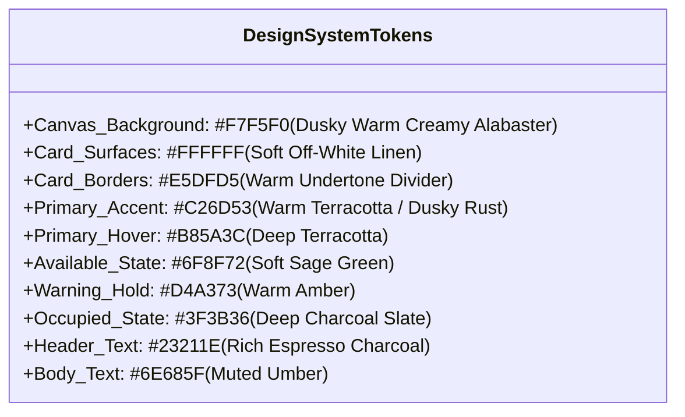
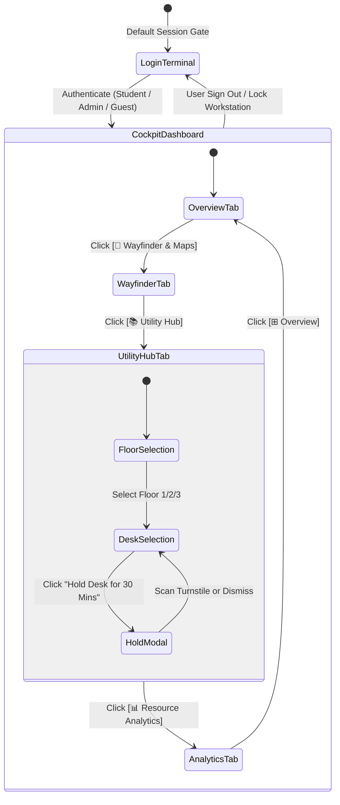

# UI/UX Specification & Design System
## CampusSphere // Unified Student Utilities & Hyperlocal Campus Navigation

**Design Philosophy:** Dusky Warm Creamy Alabaster (Tactile, Editorial, High-Density Executive Cockpit)  
**Strict Aesthetic Mandate:** NO pitch black (`#000000`), NO dark mode, NO generic saturated colors.  
**Primary Typography:** Plus Jakarta Sans (Headings & Body), JetBrains Mono (Codes, Latency & Telemetry).  

---

## 1. Visual Design System & Color Tokens



| Token Name | Hex Code | Semantic Role | Accessibility Contrast (on `#F7F5F0`) |
| :--- | :--- | :--- | :--- |
| `--bg-canvas` | `#F7F5F0` | Full page backdrop & canvas base | Baseline |
| `--bg-surface` | `#FFFFFF` | Cockpit cards, dialogs, sheets | Distinct via `#E5DFD5` border |
| `--accent-terracotta` | `#C26D53` | Primary CTAs, active segmented tabs, route polyline | 4.8:1 (WCAG AA Pass) |
| `--accent-sage` | `#6F8F72` | Available desks, open computer labs, nominal health | 3.6:1 (Badge background contrast) |
| `--accent-amber` | `#D4A373` | 30-min seat holds, shuttle line, queue surges | High legibility with `#23211E` text |
| `--occupied-slate` | `#3F3B36` | Occupied library desks, turnstile markers | 9.2:1 (AAA High Contrast) |
| `--text-primary` | `#23211E` | Headings, titles, metric values | 13.8:1 (AAA High Contrast) |
| `--text-secondary` | `#6E685F` | Subtext, timestamps, facility locations | 5.1:1 (WCAG AA Pass) |

---

## 2. Global Navigation State Machine



---

## 3. Structural 3-Column Cockpit Layout Blueprint

```
+---------------------------------------------------------------------------------------------------------+
| [🛡️ CampusSphere // Command Center]    [⊞ Overview] [🧭 Wayfinder] [📚 Utility Hub] [📊 Analytics]  [Ashmit]|
+---------------------------------------------------------------------------------------------------------+
| LEFT SIDEBAR (Alerts & Health)  | CENTER HERO (GIS Wayfinder & Live Corridor) | RIGHT SIDEBAR (Spool & AI)|
| - Live Alerts & Notices (3)     | - Route Header: ITER Gate 1 ➔ Block B Lab   | - Print Queue Status (43) |
|   • RO Plant // Filter Servicing| - Leaflet Real GIS Satellite & Canvas Map    |   • Library Xerox Latency |
|   • Library Xerox // Queue Surge|   • Real ITER Coords [20.2482, 85.8010]     |   • Reroute Recommendation|
|   • IoT Lab 304 // Walk-in Open |   • 3 Active Pulsing Map Alert Markers      | - Button: [Queue Print]   |
| - Compact Metrics (Bus, Lab, Wi)|   • Animated Khandagiri Transit Shuttle 02  | - Building Headcount      |
| - Radial Resource Gauge (68%)   | - Next Transit & Countdown (03:45 MIN)      |   • 1,420 Active Check-ins|
| - Button: [Infrastructure Logs] | - Next Class: CS-302 Data Structures Lab    | - AI Crowd Surge Predictor|
+---------------------------------------------------------------------------------------------------------+
```

---

## 4. Micro-Interactions & Motion Choreography

1. **Pulsing Map Pins:**
   - Keyframe `@keyframes pulseAlertHalo`: Continuous soft radial expansion (`0.6` to `1.6` scale) over 1.8s to 2.2s.
2. **Pedestrian Route Cadence:**
   - Terracotta dotted route (`stroke-dasharray: 6 8`) flows at 1.2 m/s pacing using CSS `stroke-dashoffset` interpolation.
3. **Turnstile Countdown Clock:**
   - Tabular monospace numbers (`JetBrains Mono`) ticking down second-by-second to avoid visual layout jumps.
4. **Haptic Hover States:**
   - Tactile card lifts (`transform: translateY(-2px)`) with warm terracotta glow accents (`rgba(194, 109, 83, 0.2)`).
