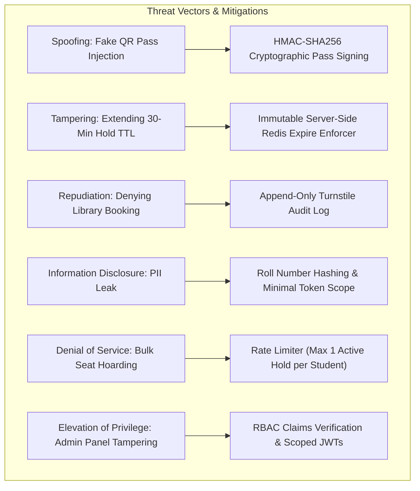
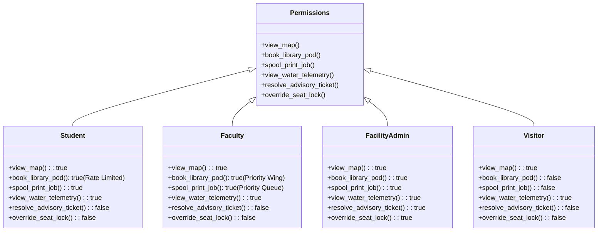
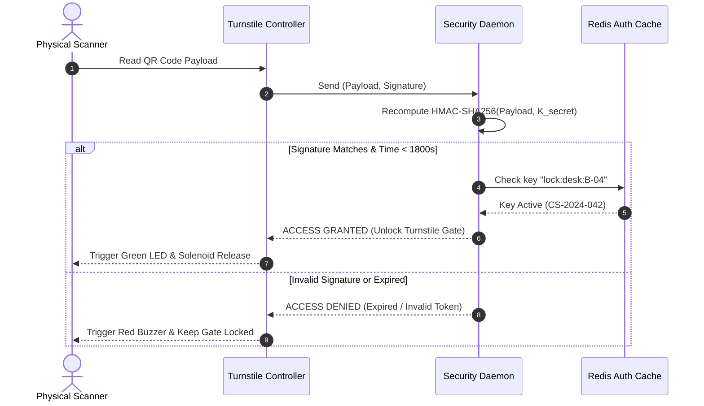

# Security Architecture & Threat Model
## CampusSphere // Unified Student Utilities & Hyperlocal Campus Navigation

**Security Framework:** STRIDE Threat Modeling & Zero Trust Architecture  
**Regulatory Compliance:** Digital Personal Data Protection Act (DPDPA 2023) & ISO/IEC 27001  

---

## 1. STRIDE Threat Model & Countermeasures

| STRIDE Category | Threat Description | Severity | CampusSphere Countermeasure |
| :--- | :--- | :--- | :--- |
| **Spoofing** | Student creates fabricated QR image to breach library turnstile. | **Critical** | Dynamic QR payload signed with HMAC-SHA256 using server master key; expires every 60 seconds. |
| **Tampering** | User alters API request to extend 30-minute hold to 4 hours. | **High** | TTL is exclusively tracked server-side in Redis; client countdown is purely presentation. |
| **Repudiation** | User denies reserving pod or generating 50-page print spools. | **Medium** | Immutable timestamped audit trails logged with institutional roll number and terminal IP. |
| **Info Disclosure** | Student names and roll numbers intercepted on campus Wi-Fi. | **High** | Enforced TLS 1.3 encryption on all transit corridors; PII stripped from client telemetry streams. |
| **Denial of Service** | Malicious bot script reserves all 24 library desks simultaneously. | **Critical** | Rate limiting: strictly 1 active hold per roll number; IP rate limits via token bucket (5 req/min). |
| **Elevation of Priv**| Student attempts to edit RO plant diagnostics or printer configurations.| **High** | Strict Role-Based Access Control (RBAC) enforcing signed JWT claims for facility admin scopes. |

---

## 2. Role-Based Access Control (RBAC) Matrix

---

## 3. Cryptographic Verification of the 30-Minute Library Pass

To prevent screenshot sharing or forged turnstile passes:
1. When a hold is granted, the backend generates an ephemeral token payload:
   $$\text{Token} = \text{SeatID} \parallel \text{RollNumber} \parallel \text{Timestamp} \parallel \text{Nonce}$$
2. The payload is signed with a secret key:
   $$\text{Signature} = \text{HMAC-SHA256}(\text{Token}, K_{\text{secret}})$$
3. The turnstile scanner decodes the QR code, recalculates the HMAC signature, verifies that $\text{CurrentTime} - \text{Timestamp} \le 1800\text{ seconds}$, and queries Redis to ensure the seat is not expired.

