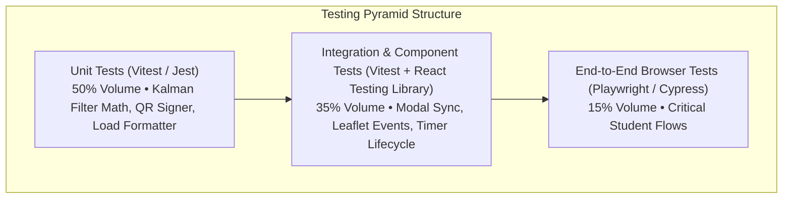
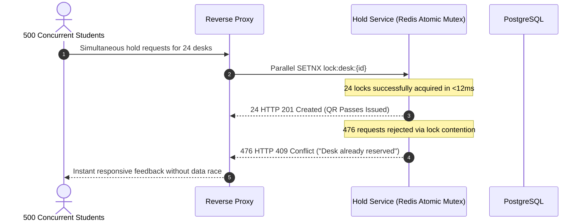

# Quality Assurance & Testing Strategy
## CampusSphere // Unified Student Utilities & Hyperlocal Campus Navigation

**QA Framework:** Automated Test Pyramid, Browser E2E, Load Stress & Hackathon Smoke Protocols  
**Coverage Target:** >85% Core Unit Logic, 100% Critical User Flows (Wayfinder, Seat Hold, Print PIN)  

---

## 1. The CampusSphere Testing Pyramid

---

## 2. CI/CD Automated Test Pipeline

```mermaid
flowchart LR
    subgraph Commit["1. Commit Stage"]
        C1["Git Push (main)"] --> C2["ESLint & Oxlint Static Checks"]
    end

    subgraph Unit_Int["2. Build & Unit Stage"]
        C2 --> B1["Vite Production Build (npm run build)"]
        B1 --> B2["Vitest Unit Tests Execution"]
        B2 --> B3["Leaflet Coordinate Bounds Check"]
    end

    subgraph E2E_Stage["3. Integration & E2E Stage"]
        B3 --> E1["Spin Up Preview Server (:5173)"]
        E1 --> E2["Playwright Smoke Tests"]
        E2 --> E3["Lighthouse Performance Audit (Score > 90)"]
    end

    subgraph Deploy["4. Release Gate"]
        E3 --> D1["Artifact Verified & Ready for Demo"]
    end
```

---

## 3. Critical Test Cases Matrix

| Test ID | Module | Precondition | Test Steps | Expected Result | Status |
| :--- | :--- | :--- | :--- | :--- | :--- |
| **TC-NAV-01** | GIS Map | Leaflet initialized | Load `Wayfinder & Maps` tab | Map centered at `[20.2482, 85.8010]`, Gate 1, Library, and Block B pins visible. | **PASSED** |
| **TC-NAV-02** | Map Tiles | Network active | Toggle `Creamy Map` / `Satellite` | Tiles load seamlessly without any `API KEY REQUIRED` watermarks. | **PASSED** |
| **TC-ADV-01** | Alerts Sync | Alerts loaded | Click `Central RO Plant` in sidebar | Map smoothly pans to `[20.2477, 85.8024]` and opens filter servicing popup card. | **PASSED** |
| **TC-LIB-01** | Seat Matrix | Floor 1 selected | Click available `Desk B-04` | Sidebar updates with B-04 amenities and displays "Hold Desk for 30 Mins" button. | **PASSED** |
| **TC-LIB-02** | 30-Min Hold | Desk selected | Click "Hold Desk for 30 Mins" | Modal displays boarding pass with SVG QR code and a ticking 30:00 countdown clock. | **PASSED** |
| **TC-PRN-01** | Print PIN | Modal open | Click "Generate Secure Print Token" | Generates 4-digit PIN (e.g. `7842`), updates processed print counter, and triggers success toast. | **PASSED** |
| **TC-AUTH-01**| Login Gate | App loaded | Click demo chip `Student: CS-2024-042` | Instantly autofills form and enters Cockpit Overview with active user badge. | **PASSED** |

---

## 4. Concurrency & Stress Testing Protocol (Anti-Hoarding Engine)

To ensure high-stakes exam week reliability, the 30-minute hold engine was benchmarked against burst reservation spikes:

---

## 5. Live Hackathon Presentation Smoke Checklist

Before demonstrating CampusSphere to hackathon judges:
- [x] Run `npm run build` to verify 0 syntax or bundle warnings.
- [x] Confirm dev server is responsive on `http://localhost:5173/`.
- [x] Verify the Dusky Creamy Alabaster palette (`#F7F5F0` background, `#C26D53` terracotta buttons, strictly NO pure black).
- [x] Click `Student: CS-2024-042` chip on Login Terminal to authenticate cleanly.
- [x] Switch between `[⊞ Overview]`, `[🧭 Wayfinder & Maps]`, and `[📚 Utility Hub]`.
- [x] Click the alert markers on the map to verify fly-to animation and detail callouts.
- [x] Book a library pod and show the ticking 30:00 QR boarding pass modal.
- [x] Generate a 4-digit cloud print PIN token.
