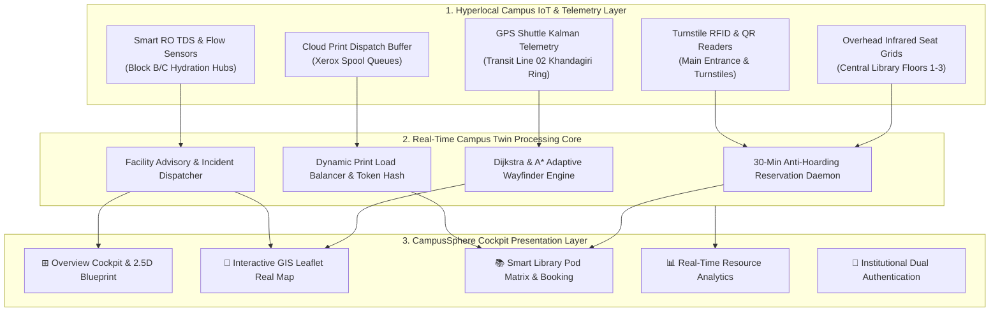
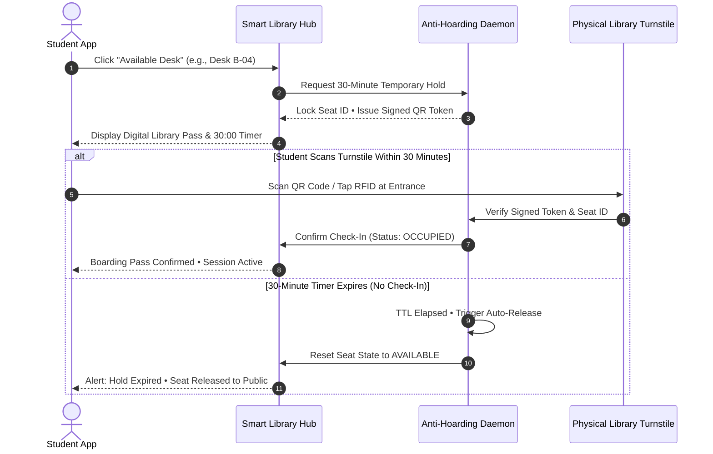
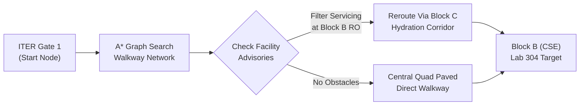

# CampusSphere // Unified Student Utilities & Hyperlocal Campus Navigation

> **Smart Digital Campus Twin & Student Command Center**  
> Custom-tailored for **ITER Campus, Siksha 'O' Anusandhan (SOA) University, Bhubaneswar, Odisha**.

Built with a strict **Dusky Warm Creamy Alabaster** aesthetic (`#F7F5F0` base, `#FFFFFF` linen cards with `#E5DFD5` borders, `#C26D53` warm terracotta primary, `#6F8F72` sage green, `#D4A373` warm amber). Strictly no pitch black and no dark mode.

---

## 🌟 Key Features

### 1. 🧭 Hyperlocal Wayfinder & Interactive GIS Real Map
- Real Leaflet GIS satellite and cartographic map centered at authentic **ITER SOA University Bhubaneswar coordinates (`20.2482° N, 85.8010° E`)**.
- **Accurate Campus Landmarks**:
  - ITER Gate 1 (Jagamara-Khandagiri Road Entrance)
  - Block B (Computer Science & Engineering, Advanced Lab 304)
  - Central Academic Library & Digital Center
  - Bansuri Guru Convention Auditorium & Admin Complex
  - E-Block & Cultural Quad Lawn
  - Gate 1 Transit Shuttle Bay
- **Live Moving Campus Transit Ring**: Line 02 Khandagiri Loop shuttle moving dynamically in real time.
- **Active Pedestrian Corridor (240m)**: Real path connecting Gate 1 through the Quad to Block B.
- **Watermark-Free Basemap Layers**: ESRI Light Gray Canvas (Creamy Map), High-Res Satellite Imagery, and Clean Blueprint Cartography.

### 2. 🚨 Real-Time Facility Advisories & Incident Notices on the Map
- **Block B Ground RO Dispenser**: Amber pulsing alert pin marking filter servicing, cartridge flush schedule, and auto-reroute to Block C 2nd Floor Hydration Hub.
- **Central Library Print Station**: Terracotta pulsing surge badge marking 6 queued jobs with automated rerouting to CS Annex.
- **IoT Lab 304 (Open Access)**: Soft sage green beacon marking 18 free walk-in benches with calibrated logic analyzers and oscilloscope hardware rigs.
- **Floating Quick Advisory Bar**: Top-left map overlay to fly directly to any alert node and view interactive resolution cards.

### 3. 📚 Smart Library Seat & Study-Pod Availability System (Utility Hub)
- **Central Library Heatmap**: 24 interactive desk tiles across 4 study zones (Zone A General Reading, Zone B Window Desks, Pods C, Quiet Room D).
- **Floor Switcher**: Ground Floor (General Reading), 1st Floor (Silent Reference & Thesis Wing), 2nd Floor (Digital E-Library & Coding Pods).
- **30-Minute Anti-Hoarding Hold**: Reserve desks with an automated 30-minute turnstile check-in boarding pass and live ticking countdown timer.
- **Automated Cloud Print Dispatcher**: Generates secure 4-digit PIN tokens (e.g. `7842`) for zero-wait campus printing.
- **Shuttle & Smart RO Water Station Telemetry**: Real-time TDS (112 ppm), filter life (84%), and countdown to next departure.

### 4. ⊞ Executive Cockpit Overview & 2.5D Architectural Blueprint
- 3-column cockpit with campus load radial gauge (68% load), pulse metrics (14 active shuttles, 8 open labs, 99.2% mesh health).
- Interactive 2.5D SVG isometric blueprint banner with pulsing advisory callouts.
- AI crowd surge predictor and live building headcount (1,420 turnstile check-ins).

### 5. 🔐 Dual-Mode Authentication Terminal
- Split authentication terminal supporting Student/Faculty institutional credentials and Visitor QR Access passes.
- Hackathon demo quick-fill chips for instant evaluator access (`Student: CS-2024-042`, `Admin: Facility Desk`).
- Live telemetry companion card displaying campus pulse metrics.

---

## 🏗️ System Architecture & Telemetry Pipeline



---

## 🔄 Smart Library 30-Minute Hold & Verification Flow



---

## 🗺️ Incident-Aware Hyperlocal Navigation Pipeline



---

## 🛠️ Technology Stack
- **Frontend**: React 19, Vite 8
- **Styling**: Vanilla CSS with strict HSL tokens & Dusky Creamy Alabaster palette
- **Mapping & GIS**: Leaflet, Carto/ESRI GIS tile providers
- **Diagrams**: Mermaid.js workflow & architecture diagrams
- **Icons**: Lucide React
- **Typography**: Plus Jakarta Sans, JetBrains Mono

---

## 🚀 Getting Started

### Prerequisites
- Node.js (v18 or higher recommended)
- npm or pnpm

### Installation
```bash
# Clone repository
git clone https://github.com/Hritik983567-Art/Campus_Sphere.git
cd Campus_Sphere

# Install dependencies
npm install

# Start development server
npm run dev
```

### Production Build
```bash
npm run build
npm run preview
```

---

## 👥 Hackathon Team
- **Project**: CampusSphere // Unified Student Utilities & Hyperlocal Campus Navigation
- **Campus**: ITER, Siksha 'O' Anusandhan (SOA) Deemed to be University, Bhubaneswar, Odisha


